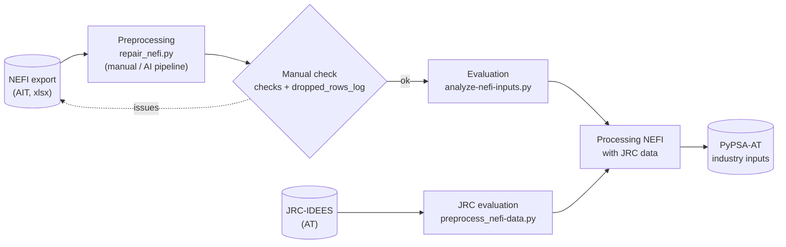

  [](https://github.com/maxnutz/pypsa_validation_processing/blob/master/LICENSE) [](https://github.com/IAMconsortium/pyam)

# ESM_scenario_preprocessing

Preprocesses scenario inputs from the NetZero 2040 project to serve as input for PyPSA-AT.

## Quick start from Zero
1. install pixi on your machine/laptop ([Complete Guide](https://pixi.prefix.dev/latest/installation/))
  ```bash
  curl -fsSL https://pixi.sh/install.sh | sh
  ```
2. restart your terminal
3. go to the project folder (there `pixi.toml` lives)
4. start the marimo notebook with
  ```bash
  pixi run marimo edit
  ```
5. a browser window will open, showing all available notebooks. If you are working on a server, you may have to open the browser-window by yourself, by copy-pasting the link displayed in the terminal. 

## Github collaboration
- You can't directly push on branch "main", as it is protected
- If you work on code, you want to push, create a branch (`git checkout -b <your branch name>`), add files, commit and push with `git push`.
- For merging into main, open a pull request online (Tab "Pull requests"). Sourcery will review your pull request automatically
## Requirements

- Python 3.10+
- pixi (recommended for environment management)

Core dependencies:

- pandas
- pyam-iamc
- marimo

## Installation of the package

### With pip

```bash
python -m pip install -e .
```

### With pixi

```bash
pixi install
pixi shell
```

## Project structure

- `pyproject.toml`: pip-installable package configuration and pixi environment/dependency configuration (`[tool.pixi.*]`)
- `src/esm_scenario_preprocessing/`: Python package source
- `resources/`: local input data folder (ignored by git)
- `sector-inputs/`: collection of marimo notebooks processing scenario input data
- `nefi_preprocessing/`: first pipeline step – harmonizes the raw NEFI (AIT) industry export into a standard long table (`repair_nefi.py`, see its own `README.md` for all rules and data quirks)

## Industry workflow



1. **Preprocessing:** `nefi_preprocessing/repair_nefi.py` harmonizes the raw NEFI export into the standard output file (see below).
2. **Manual check:** review the `checks` and `dropped_rows_log` sheets and the open questions in `nefi_preprocessing/README.md`. Report source issues back to AIT.
3. **Evaluation:** `sector-inputs/analyze-nefi-inputs.py` evaluates the NEFI scenarios.
4. **JRC evaluation:** `sector-inputs/preprocess_nefi-data.py` evaluates JRC-IDEES data for Austria (added value vs. physical output).
5. **Processing:** the NEFI data are combined with the JRC data to produce the PyPSA-AT industry inputs.

## NEFI standard output file

`nefi_preprocessing/repair_nefi.py` is a script for use in an **AI pipeline**. An AI agent receives the NEFI source workbook, `repair_nefi.py` and the prompt in `nefi_preprocessing/prompt_for_nefi_inputs.txt`. It runs the script unchanged, formats the output, verifies the checks listed in the prompt and documents the result in a README. The script can also be run manually.

The script reads the NEFI source workbook (tabs `Scenario 1` and `Scenario 2.a`) and writes the standard input for all following steps:

```bash
pixi run python nefi_preprocessing/repair_nefi.py <source.xlsx> <output_dir>
```

Output: `<output_dir>/NEFI_v3_energy_by_carrier_long.xlsx` with three sheets (plus a small `summary.json` with the row count).

### Sheet `data` (the deliverable)

Long format, one row per `scenario × sector × carrier × year`:

| Column     | Type  | Values |
|------------|-------|--------|
| `scenario` | str   | `Scenario1` (POI_2026), `Scenario2a` (ZEM) |
| `sector`   | str   | `IronSteel`, `Chemical`, `PulpPaper`, `NonMetalicMinerals`, `Machinery`, `NonFerrousMetals`, `TransportEquipment`, `FoodAndBeverages`, `Wood`, `Textiles`, `NonSpecifiedIndustry`, `Construction`, `Mining` |
| `carrier`  | str   | `Waste`, `Biofuels`, `Electricity`, `ElectricityHP`, `SolarThermal`, `Coal`, `Oil`, `GasGridMix`, `DistrictHeating`, `Hydrogen` |
| `unit`     | str   | always `TWh` (final energy per year) |
| `year`     | int   | 2017–2021, 2025, 2030, 2035, 2040, 2045, 2050 |
| `value`    | float | full source precision, no rounding |

- 2 × 13 × 10 × 11 = 2,860 rows. Every combination is present; carriers a sector does not use are `0`.
- All rows are additive: no subtotals or totals. Summing over `carrier` gives the sector total (equals AIT's "Total energy").
- `GasGridMix` = methane-type gases only (natural gas + biogas + synthetic CH₄), never hydrogen.
- `Hydrogen` = total hydrogen demand (pipeline and on-site, not distinguished). Electricity for H₂ production is *not* included in `Electricity` (no double counting).

### Sheet `checks`

One row per `scenario × sector × year` comparing the result with the source: `sum_carriers` vs. `AIT_total_energy` (`diff_total`, `total_ok`), rebuilt `GasGridMix` vs. the source gas aggregate (`diff_gas`, `gas_ok`), and the dropped `El_for_H2_in_source_not_used`.

### Sheet `dropped_rows_log`

Every source row not carried into `data`, with columns `scenario`, `sector`, `source_cell`, `source_label`, `action` (reason for dropping). 
